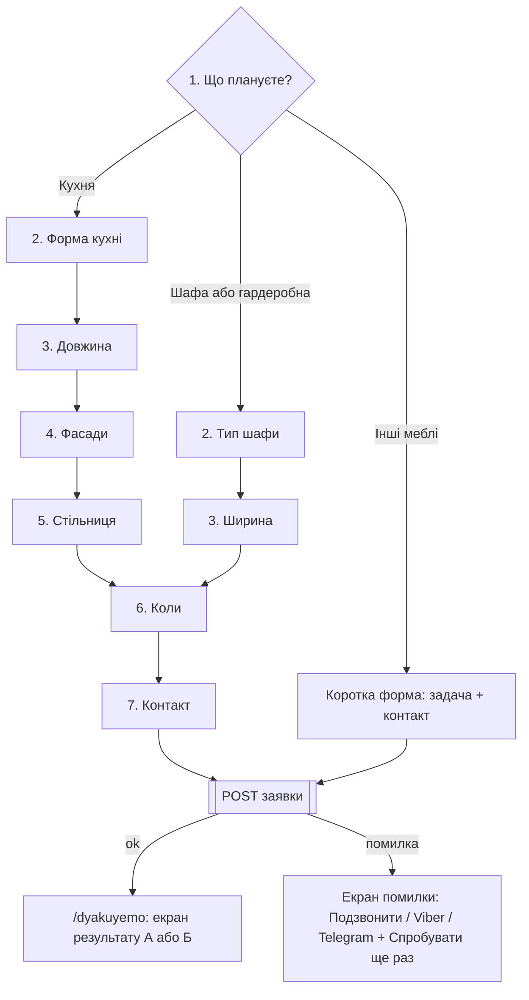

# ARCHITECTURE.md — сайт «ВИМІР», кухні та меблі на замовлення, Черкаси

Статус: фаза 1, утверждено владельцем 2026-10-16 с правками (хостинг adm.tools, PHP-приёмник заявок, деплой через GitHub Actions).
Дата: 2026-10-16.
Источники: `CLAUDE.md` (главный, при расхождении прав он), `docs/TZ.md`, `docs/PHASES.md`.
Код в этой фазе не пишется. Пакеты не ставятся. Ниже везде, где нужен факт о бизнесе, стоит заглушка `{{...}}` (раздел 5).

---

## 0. Принципы, которые определяют все решения

1. **Одна цель: заявка.** Любой компонент или скрипт, который не помогает получить заявку или клик по телефону, Viber или Telegram, не делаем.
2. **Статический HTML.** Каждая страница собирается заранее. JS подключаем только там, где без него нельзя: квиз, формы, слайдер, фильтр.
3. **Мобильный первым.** Макет делаем на 375 px, проверяем на 320 px (ничего не должно уезжать вбок), потом 768 и 1280 px.
4. **Факты только из одного места.** Все факты лежат в `src/content/facts.ts`, данные кейсов — в файлах кейсов. Если факта нет, показываем заглушку, и в продакшен она попасть не может.
5. **Бюджет производительности** (инженерные цели, а не факты о бизнесе):

| Метрика (мобильный, Lighthouse, медленный 4G) | Цель |
|---|---|
| Lighthouse Performance | ≥ 90 |
| LCP (первый экран) | ≤ 2,5 с |
| CLS | ≤ 0,05 |
| JS главной без аналитики, gzip | ≤ 25 КБ |
| JS квиза, gzip | ≤ 10 КБ |
| CSS, gzip | ≤ 20 КБ |
| Шрифты: файлов с preload | 2 |
| Фото первого экрана (мобильный, AVIF/WebP) | ≤ 120 КБ |
| Видео | не грузится до клика или до появления в зоне видимости |

---

## 1. Стек и почему

### 1.1. Сводка решений

| Слой | Решение | Почему | Что отвергли |
|---|---|---|---|
| Фреймворк | **Astro 5**, `output: 'static'` | Отдаёт чистый HTML с нулём JS по умолчанию, поддерживает островки, Content Collections и оптимизацию картинок (`astro:assets`). Под Lighthouse ≥ 90 подходит лучше всего | Next.js: тяжёлый рантайм React, для лендинга избыточен. 11ty: нет типизированных коллекций и встроенной оптимизации картинок. Если к фазе 2 стабильна Astro 6, проверить совместимость: документ от мажорной версии не зависит |
| CSS | **Tailwind CSS 4** через `@tailwindcss/vite` | Конфиг пишется прямо в CSS (`@theme`), поэтому `src/styles/tokens.css` одновременно задаёт дизайн-токены и тему Tailwind, отдельного JS-конфига нет. Сборка быстрее, в бандл попадают только использованные классы. Стандартную палитру отключаем (`--color-*: initial`), так что «чужой» цвет в коде просто не соберётся | Tailwind 3.4: возвращаемся к нему, только если в аналитике окажется заметная доля браузеров старше Safari 16.4 или Chrome 111 (риск Т11) |
| Интерактивность | **Vanilla TypeScript** в `<script>` Astro, без UI-фреймворка | Разметку квиза и форм рендерит Astro на сервере, скрипт только переключает состояние. Нет гидрации и рантайма, весь JS сайта укладывается в несколько КБ. Квиз устроен как простой конечный автомат, для него не нужен ни VDOM, ни реактивность | Preact (около 4–5 КБ gzip плюс гидрация): запасной вариант только для квиза (`client:visible`), если логика сильно разрастётся. React: слишком тяжёлый |
| Нативные элементы вместо библиотек | `<details>` для FAQ, `<dialog>` для попапа замера и галереи, `<input type="range">` для слайдера «було / стало», CSS scroll-snap для галереи | Ноль КБ JS или почти ноль, доступность из коробки, на телефоне работают пальцем | Swiper, lightbox-библиотеки |
| Кейсы | **Astro Content Collections** (Content Layer, `glob` loader), Markdown с frontmatter в `src/content/cases/` | Схема Zod проверяет каждый кейс при сборке: если не хватает поля или фото, сборка падает и выдаёт понятную ошибку. Кейс добавляется одним файлом и папкой фото | Headless CMS с базой: лишняя зависимость и платный тариф |
| Кейсы: как добавлять | **Markdown-файлы** в `src/content/cases/` + папка фото, без админки (решение владельца) | Достаточно для 15–25 кейсов; схема Zod ловит ошибки при сборке. Админку можно добавить позже поверх тех же файлов | Git-based CMS — отложено |
| Шрифты | **Self-host через `@fontsource`**: `@fontsource/unbounded` (500), `@fontsource-variable/manrope` (ось 400–600), `@fontsource/jetbrains-mono` (500) | Шрифты отдаются с того же домена, что и сайт: нет отдельных DNS и TLS до Google, работает preload, нет сторонних запросов (GDPR-подобные претензии к Google Fonts тоже снимаются). Подключаем только подмножества `cyrillic` и `latin`: в `cyrillic` (U+0400–045F, U+0490–0491) есть і, ї, є, ґ, в `latin` есть апостроф U+02BC и типографский U+2019. `font-display: swap`, preload только двух файлов: Manrope cyrillic и Unbounded cyrillic 500 (H1) | Google Fonts CDN: лишнее соединение, preload не контролируем |
| Знак гривны | Пишем «грн», символ ₴ не используем | ₴ (U+20B4) входит только в подмножество `cyrillic-ext`, ради него пришлось бы грузить лишний файл | — |
| Бэкенд форм (фаза 6) | **PHP-скрипт `api/lead.php`** на хостинге владельца (PHP 8.1+), без фреймворка и Composer | На виртуальном хостинге нет serverless-функций и Node. PHP есть «из коробки»; один файл легко проверить и перенести. Секреты — в конфиге вне публичной папки (раздел 7.4) | Serverless-платформы — хостинг уже выбран владельцем |
| Email-резерв | **Почта хостинга**: SMTP-ящик на домене (после регистрации домена), `mail()` как запасной вариант | Ничего платного и стороннего, SPF/DKIM настраиваются в панели adm.tools | Сторонние email-API — лишний внешний аккаунт |
| Хостинг | **Виртуальный хостинг владельца, adm.tools (Хостинг Україна)**: статика из `dist/` + PHP 8.1+, SSH/SFTP, бесплатный SSL | Решение владельца. Сайт — чистая статическая сборка Astro, без серверного рендеринга; Apache отдаёт файлы, редиректы — в `.htaccess` | — |
| Деплой (фаза 9) | **GitHub Actions**: push в main → `npm ci` → сборка → загрузка `dist/` и `api/` по SFTP | Доступы только в GitHub Secrets, владелец вносит сам (раздел 7.5) | Ручная загрузка — ошибки и забытые файлы |
| Тесты | Playwright (проекты 375 × 812 и 1280 × 800), `@axe-core/playwright`, Vitest для чистой логики (цена квиза, схема заявки, маска телефона), Lighthouse CI | Задано в CLAUDE.md и PHASES.md | — |
| Проверка типов | `astro check` входит в `npm run build` | По CLAUDE.md сборка должна проходить без ошибок и предупреждений | — |
| Окружение | Node 22 LTS, npm | — | — |

### 1.2. Где на сайте есть JS (полный список островков)

| Островок | Где | Что делает | Загрузка |
|---|---|---|---|
| `menu` | Шапка | Бургер, `aria-expanded` | Сразу (крошечный) |
| `cta-arbiter` | Все страницы | Следит, чтобы на экране был максимум один жёлтый элемент (раздел 6.9) | Сразу |
| `bottom-bar` | Все страницы, < 1024 px | Прячет панель при фокусе в поле формы и при открытом `<dialog>` | Сразу |
| `utm` | Все страницы | Запоминает UTM и click-id (раздел 7) | Сразу |
| `portfolio-filter` | Главная (блок 3), `/roboty` | Фильтрует уже отрендеренные карточки по `data-*` и синхронизирует `?type=&shape=` | При появлении |
| `before-after` | Главная (блок 4) | Связывает range-ползунок с `clip-path` | При появлении |
| `quiz` | Главная (блок 5) | Автомат шагов, прогресс, хранение ответов, отправка | При появлении |
| `lead-form` | Все формы | Маска +380, валидация, отправка, ошибки | При фокусе или появлении |
| `video-facade` | Блок 6, кейс | Показывает постер, а `<video>` подставляет по клику | При клике |
| `gallery` | Кейс | Полноэкранный просмотр в `<dialog>` | При клике |
| `analytics-loader` | Все (фаза 7) | GTM, Pixel и Clarity грузит после первого взаимодействия или через `requestIdleCallback` с таймаутом | Отложенно |

Если JS не загрузился: формы всё равно отправляются обычным POST (раздел 7), FAQ работает, кнопки «Розрахувати» ведут на `/#kvyz`.

---

## 2. Структура папок

```
stroika/
├── .github/workflows/
│   └── deploy.yml                  # сборка и SFTP-загрузка на adm.tools (ФАЗА 9)
├── api/
│   ├── lead.php                    # приём заявок: Telegram + Apps Script + email (ФАЗА 6)
│   ├── lead-config.example.php     # образец конфига без значений; настоящий — вне публичной папки
│   └── .htaccess                   # доступ только к lead.php
├── integrations/
│   └── google-apps-script/Code.gs  # doPost для Google Sheets (вставляется в таблицу вручную)
├── docs/
│   ├── ARCHITECTURE.md
│   ├── PLAN.md                     # от агента planner
│   ├── PHASES.md
│   ├── TZ.md
│   └── screens/                    # скриншоты 375 / 768 / 1280 по задачам
├── public/
│   ├── brand/
│   │   ├── logo.svg                # «Кутник», текст в кривых (пока временный, TODO)
│   │   ├── logo-dark.svg
│   │   └── mark.svg                # угольник + В: favicon, аватарки
│   ├── photos/
│   │   ├── video/                  # mp4 монтажа и бригады (не обрабатываются сборкой)
│   │   └── og/                     # картинки для соцсетей
│   ├── .htaccess                   # редиректы (/kukhni → /, HTTPS), кэш, 404
│   ├── favicon.svg
│   └── apple-touch-icon.png
├── scripts/
│   ├── check-placeholders.mjs      # ищет «{{» и data-placeholder в dist/
│   └── check-words.mjs             # ищет запрещённое слово из CLAUDE.md, п.3, в src/ и dist/
├── src/
│   ├── assets/
│   │   └── photos/                 # фото для оптимизации astro:assets (утверждено)
│   │       ├── cases/<slug>/       # 01.jpg … 15.jpg, cover.jpg
│   │       ├── team/
│   │       ├── before-after/
│   │       └── hero/
│   ├── components/
│   │   ├── ui/
│   │   │   ├── Button.astro            # primary (жёлтая, только заявка) / secondary / outline / link
│   │   │   ├── Icon.astro              # inline SVG-спрайт
│   │   │   ├── Fact.astro              # выводит факт или видимую заглушку
│   │   │   ├── PlaceholderImage.astro  # серый блок с подписью размера
│   │   │   ├── Picture.astro           # обёртка <Picture> с AVIF/WebP и srcset
│   │   │   ├── SectionTitle.astro
│   │   │   ├── Dimension.astro         # мотив размерной линии (декор, aria-hidden)
│   │   │   ├── Badge.astro             # сезонный бейдж
│   │   │   ├── Chip.astro              # фильтры
│   │   │   ├── Accordion.astro         # на <details>
│   │   │   ├── BeforeAfter.astro
│   │   │   ├── VideoFacade.astro
│   │   │   └── form/
│   │   │       ├── Input.astro
│   │   │       ├── PhoneInput.astro    # маска +380
│   │   │       ├── Textarea.astro
│   │   │       ├── Select.astro
│   │   │       ├── ConsentCheckbox.astro
│   │   │       └── Honeypot.astro
│   │   ├── layout/
│   │   │   ├── Header.astro            # блок 0
│   │   │   ├── MobileMenu.astro
│   │   │   ├── MobileBottomBar.astro   # Подзвонити / Viber / Розрахувати
│   │   │   ├── Footer.astro            # блок 14
│   │   │   ├── SeoHead.astro           # title, description, canonical, OG, robots
│   │   │   ├── JsonLd.astro            # LocalBusiness, FAQPage (фаза 7)
│   │   │   └── SkipLink.astro
│   │   ├── sections/                   # блоки главной, используются и на /mebli
│   │   │   ├── Hero.astro              # 1
│   │   │   ├── TrustNumbers.astro      # 2
│   │   │   ├── Portfolio.astro         # 3
│   │   │   ├── BeforeAfterSection.astro# 4
│   │   │   ├── QuizSection.astro       # 5
│   │   │   ├── Team.astro              # 6
│   │   │   ├── Process.astro           # 7
│   │   │   ├── Prices.astro            # 8
│   │   │   ├── Materials.astro         # 9
│   │   │   ├── Reviews.astro           # 10
│   │   │   ├── WarrantyPayment.astro   # 11
│   │   │   ├── Faq.astro               # 12
│   │   │   └── FinalCta.astro          # 13 (форма замера + карта зоны)
│   │   ├── cases/
│   │   │   ├── CaseCard.astro
│   │   │   ├── CaseGrid.astro
│   │   │   ├── CaseFilter.astro
│   │   │   ├── CaseGallery.astro
│   │   │   ├── CaseFacts.astro         # район, срок, цена «від», материалы
│   │   │   └── RelatedCases.astro
│   │   ├── forms/
│   │   │   ├── ZamirForm.astro         # имя, телефон, удобное время
│   │   │   ├── ZamirModal.astro        # <dialog> из шапки
│   │   │   ├── CaseLeadForm.astro      # «Хочу так само»
│   │   │   ├── RemontForm.astro
│   │   │   ├── ContactForm.astro       # короткая, /kontakty
│   │   │   └── SubmitError.astro       # экран «не вдалося надіслати»
│   │   └── quiz/
│   │       ├── Quiz.astro              # контейнер, все шаги в разметке
│   │       ├── QuizProgress.astro
│   │       ├── QuizStep.astro
│   │       ├── QuizOption.astro        # карточка-вариант со схемой
│   │       ├── QuizContact.astro       # шаг 7
│   │       ├── QuizShortForm.astro     # Інші меблі
│   │       └── QuizResult.astro        # экран А / Б (рендерится на /dyakuyemo)
│   ├── content/
│   │   ├── cases/                      # <slug>.md — один файл = один кейс
│   │   ├── facts.ts                    # ВСЕ глобальные факты и заглушки, флаги А/Б и бейджа
│   │   └── faq.ts                      # вопросы и ответы (ответы собираются из facts)
│   ├── content.config.ts               # схема коллекции cases
│   ├── layouts/
│   │   ├── BaseLayout.astro            # html lang="uk", шрифты, Header, Footer, BottomBar
│   │   └── CaseLayout.astro
│   ├── lib/
│   │   ├── facts.ts                    # isPlaceholder(), num(), formatUAH(), formatPhone()
│   │   ├── cases.ts                    # getRelated(), buildAlt(), seoForCase()
│   │   ├── seo.ts
│   │   ├── analytics.ts                # track(): заглушка до фазы 7, потом dataLayer
│   │   ├── cta-arbiter.ts
│   │   ├── phone.ts                    # маска и нормализация к +380XXXXXXXXX
│   │   ├── quiz/
│   │   │   ├── types.ts
│   │   │   ├── config.ts               # шаги, варианты, граф переходов
│   │   │   ├── machine.ts              # next/back/progress
│   │   │   ├── storage.ts              # localStorage с TTL
│   │   │   └── price.ts                # расчёт для экрана А
│   │   └── lead/
│   │       ├── schema.ts               # Zod-схема заявки (клиент; та же логика повторена в PHP)
│   │       ├── utm.ts
│   │       └── submit.ts
│   ├── pages/
│   │   ├── index.astro                 # / — лендинг кухонь, 14 блоков
│   │   ├── roboty/
│   │   │   ├── index.astro             # /roboty
│   │   │   └── [slug].astro            # /roboty/<slug>
│   │   ├── mebli.astro
│   │   ├── kontakty.astro
│   │   ├── dyakuyemo.astro             # noindex; Lead; экран результата квиза
│   │   ├── polityka.astro
│   │   ├── styleguide.astro            # noindex, нет в sitemap (конец фазы 3)
│   │   └── 404.astro
│   └── styles/
│       ├── tokens.css                  # @theme: цвета, шрифты, шкалы, брейкпоинты
│       └── global.css                  # @import "tailwindcss"; база, типографика, focus
├── tests/
│   ├── e2e/
│   │   ├── layout.spec.ts              # нет горизонтального скролла 320/375/768/1280
│   │   ├── bottom-bar.spec.ts
│   │   ├── quiz.spec.ts                # 3 ветки, «Назад», восстановление, прогресс
│   │   ├── forms.spec.ts
│   │   ├── a11y.spec.ts
│   │   └── prod-content.spec.ts        # 0 заглушек (только для продакшен-сборки)
│   └── unit/
│       ├── price.test.ts
│       ├── lead-schema.test.ts
│       └── phone.test.ts
├── astro.config.mjs                    # site: SITE_URL
├── playwright.config.ts
├── lighthouserc.json
├── tsconfig.json
├── package.json
└── CLAUDE.md
```

Адреса страниц и где они индексируются:

| Адрес | Индексация | Sitemap |
|---|---|---|
| `/`, `/roboty`, `/roboty/<slug>`, `/mebli`, `/kontakty`, `/polityka` | да | да |
| `/dyakuyemo`, `/styleguide`, `404` | `noindex` | нет |
| Любая сборка с `SITE_ENV` ≠ `production` (локально, технический адрес хостинга) | `noindex` на всех страницах | — |

---

## 3. Модель данных кейса портфолио

### 3.1. Поля

| Поле | Тип | Обяз. | Описание |
|---|---|---|---|
| *(имя файла)* | `^[a-z0-9-]+$` | да | Это и есть slug, то есть адрес `/roboty/<slug>`. Транслит по правилам КМУ 2010, например `kutova-kukhnia-<rayon>` |
| `title` | string ≤ 70 | да | «Кутова кухня з білими фасадами» |
| `category` | `'kitchen' \| 'wardrobe' \| 'furniture'` | да | Фильтр на `/roboty`: Кухні / Шафи / Інші меблі |
| `kitchenShape` | `'pryama' \| 'kutova' \| 'p-podibna' \| 'ostriv'` | да, если `kitchen` | Фильтр на главной и на `/roboty` |
| `wardrobeType` | `'kupe' \| 'rozpashna' \| 'harderobna' \| 'peredpokii'` | да, если `wardrobe` | Подпись карточки, подбор похожих |
| `district` | string | да | Район Черкас или населённый пункт области |
| `altBase` | string | да | Начало alt-текста: «Кутова кухня з білими фасадами» |
| `cover` | image | да* | Обложка карточки |
| `coverFocus` | string `'X% Y%'`, по умолчанию `'50% 50%'` | нет | Точка кадра обложки при обрезке до 4:3 (`object-position`) |
| `gallery` | список `{ src: image, alt?: string, caption?: string }`, от 8 до 15 | да* | Порядок в файле = порядок на странице |
| `video` | `{ src: string ('/photos/video/…'), poster: image, title: string }` | нет | Грузится по клику |
| `task` | string (1–3 предложения) | да | «Задача клієнта» |
| `solution` | string (1–4 предложения) | да | «Рішення» |
| `materials` | список `{ label: string, value: string }` | да | Например `{ label: 'Фасади', value: '…' }` |
| `hardware` | список строк | нет | Бренды фурнитуры, только из `facts.hardwareBrands` |
| `durationDays` | целое число или заглушка | да | «Термін» |
| `priceFrom` | целое число (грн) или заглушка | нет | «Ціна від». Если поля нет, строка цены не выводится |
| `review` | `{ author: string, district?: string, text?: string, screenshot?: image, source: 'google' \| 'instagram' \| 'other', url?: string }` | нет | Только реальный отзыв: нужен `text` или `screenshot` |
| `related` | список ссылок на кейсы, ≤ 3 | нет | Ручной выбор похожих, имеет приоритет над автоподбором |
| `featured` | boolean, по умолчанию `false` | нет | Показывать на главной (блок 3) |
| `featuredOrder` | number | нет | Порядок на главной |
| `date` | дата | да | Дата сдачи объекта, по ней сортировка |
| `seo` | `{ title?: string ≤ 60, description?: string ≤ 160 }` | нет | Если не задано, собирается по шаблону (3.4) |
| `placeholder` | boolean, по умолчанию `false` | нет | Демо-кейс для фаз 2–4: фото не обязательны, в продакшен-сборку не попадает |
| `draft` | boolean, по умолчанию `false` | нет | Черновик: виден при `SITE_ENV` ≠ `production`, в продакшен не попадает |
| *(тело Markdown)* | Markdown | нет | Подробная история объекта, если есть |

`*` Поля `cover` и `gallery` (минимум 8) обязательны только при `placeholder: false`. В демо-кейсе вместо фото выводится `PlaceholderImage`.

Заглушки в файлах кейсов — сознательное исключение из правила «все заглушки в `facts.ts»`: факты конкретного объекта живут в файле этого объекта. Демо-кейсы помечены `placeholder: true`, а проверка `dist/` (раздел 5.4) ловит любые `{{` независимо от того, откуда они пришли.

### 3.2. Схема (псевдокод `src/content.config.ts`)

```ts
const ph = z.string().regex(/^\{\{[A-Z0-9_]+\}\}$/);   // заглушка
const intOrPh = z.union([z.number().int().positive(), ph]);

cases = defineCollection({
  loader: glob({ pattern: '**/*.md', base: './src/content/cases' }),
  schema: ({ image }) => z.object({
    title: z.string().max(70),
    category: z.enum(['kitchen', 'wardrobe', 'furniture']),
    kitchenShape: z.enum(['pryama', 'kutova', 'p-podibna', 'ostriv']).optional(),
    wardrobeType: z.enum(['kupe', 'rozpashna', 'harderobna', 'peredpokii']).optional(),
    district: z.string(),
    altBase: z.string(),
    cover: image().optional(),
    gallery: z.array(z.object({ src: image(), alt: z.string().optional(), caption: z.string().optional() })).max(15).default([]),
    video: z.object({ src: z.string().startsWith('/photos/video/'), poster: image(), title: z.string() }).optional(),
    task: z.string(),
    solution: z.string(),
    materials: z.array(z.object({ label: z.string(), value: z.string() })).min(1),
    hardware: z.array(z.string()).optional(),
    durationDays: intOrPh,
    priceFrom: intOrPh.optional(),
    review: z.object({ ... }).optional(),
    related: z.array(reference('cases')).max(3).optional(),
    featured: z.boolean().default(false),
    featuredOrder: z.number().optional(),
    date: z.coerce.date(),
    seo: z.object({ title: z.string().max(60).optional(), description: z.string().max(160).optional() }).optional(),
    placeholder: z.boolean().default(false),
    draft: z.boolean().default(false),
  }).superRefine((c, ctx) => {
    // kitchen      → нужен kitchenShape
    // wardrobe     → нужен wardrobeType
    // !placeholder → нужен cover, gallery.length >= 8, нет заглушек в полях
    // review       → нужен text или screenshot
  }),
});
```

### 3.3. Пример файла `src/content/cases/kutova-kukhnia-demo-01.md`

```markdown
---
title: "Кутова кухня {{CASE_FACADE_DESCRIPTION}}"
category: kitchen
kitchenShape: kutova
district: "{{CASE_DISTRICT}}"
altBase: "Кутова кухня {{CASE_FACADE_DESCRIPTION}}"
task: "{{CASE_TASK}}"
solution: "{{CASE_SOLUTION}}"
materials:
  - { label: "Фасади", value: "{{CASE_FACADES}}" }
  - { label: "Стільниця", value: "{{CASE_COUNTERTOP}}" }
  - { label: "Фурнітура", value: "{{CASE_HARDWARE}}" }
durationDays: "{{CASE_DURATION_DAYS}}"
priceFrom: "{{CASE_PRICE_FROM}}"
featured: true
featuredOrder: 1
date: 2026-01-01
placeholder: true
---
```

Пример реального кейса после фазы 5: `placeholder: false`, есть `cover`, `gallery` содержит пути вида `../../assets/photos/cases/<slug>/01.jpg`, все значения настоящие.

### 3.4. Производные данные

**Alt-текст фото.** `buildAlt(case, i)`:
- если у фото задан `alt`, берём его;
- иначе `${altBase}, Черкаси, район ${district}`, а для фото начиная со второго добавляем `, фото ${i}`.

Результат: «Кутова кухня з білими фасадами, Черкаси, район …». Если `district` — населённый пункт области, а не район города, вместо «Черкаси, район X» пишем «X, Черкаська область» (определяется по списку районов в `facts.serviceArea.cityDistricts`).

**SEO кейса по умолчанию:**
- title: `${title}, Черкаси — Вимір` (≤ 60 символов, при превышении `title` обрезается по слову);
- description: `${title} у районі ${district}. Термін ${durationDays} днів. Безкоштовний замір — залиште заявку.` (≤ 160 символов). Пока поля содержат заглушки, description тоже содержит заглушку и ловится проверкой 5.4.

**Форма «Хочу так само».** `CaseLeadForm` получает `caseSlug` и `title`, заголовок формы: «Хочу так само: {title}». В заявку уходят `case.slug` и `case.title` (раздел 4.8).

**Аналитика.** На странице кейса срабатывает `ViewContent` с `content_name = title`, `content_category = category`.

### 3.5. Подбор 3 похожих кейсов (на этапе сборки, в `getStaticPaths`)

1. Берём кейсы из `related`, если они заданы, без черновиков и демо (в продакшене).
2. Добираем до 3 по сумме баллов среди остальных кейсов, текущий исключаем:
   - та же `category`: +100;
   - та же `kitchenShape` или `wardrobeType`: +30;
   - совпадение значений в `materials`: +5 за каждое;
   - тот же `district`: +5.
3. При равенстве баллов выше тот, у кого свежее `date`.
4. Если в категории меньше 3 кейсов, добираем из других категорий по тем же правилам.
5. Если кейсов всего меньше 4, блок показывает столько, сколько есть. Если нет ни одного, блок скрыт.

### 3.6. Как добавить кейс (для владельца или помощника)

1. Создать папку `src/assets/photos/cases/<slug>/` и положить туда `cover.jpg` и от 8 до 15 фото `01.jpg`…`15.jpg`. Длинная сторона ≥ 2000 px, исходник любого веса: AVIF/WebP и размеры сборка сделает сама.
2. Видео, если есть: `public/photos/video/<slug>.mp4` (H.264, 720p) и постер.
3. Скопировать любой файл кейса, переименовать в `<slug>.md`, заполнить поля.
4. Закоммитить и запушить. GitHub Actions соберёт сайт и выложит на хостинг; если чего-то не хватает, сборка упадёт с указанием поля, и на сайт ничего не попадёт.

---

## 4. Модель данных квиза

### 4.1. Шаги

Номер «по ТЗ» используется в событиях `quiz_step_N`.

| ID шага | № по ТЗ | Ветка | Вопрос (UI) | Варианты: `value` → подпись |
|---|---|---|---|---|
| `goal` | 1 | все | Що плануєте? | `kitchen` → Кухня; `wardrobe` → Шафа або гардеробна; `other` → Інші меблі; `custom` → Інше, нестандартне (ссылка на #zapyt) |
| `kitchenShape` | 2 | кухня | Яка форма кухні? | `pryama` → Пряма; `kutova` → Кутова; `p-podibna` → П-подібна; `ostriv` → З островом (схематичные SVG) |
| `kitchenLength` | 3 | кухня | Приблизна довжина | `lt3` → До 3 м; `3to4` → 3–4 м; `4to5` → 4–5 м; `gt5` → Більше 5 м; `unknown` → Не знаю — приїдемо заміряти |
| `facade` | 4 | кухня | Фасади | `mdf-film` → МДФ у плівці; `mdf-painted` → Фарбований МДФ; `dsp` → ДСП; `advise` → Порадьте. Вариант с деревом из ТЗ убран до подтверждения материалов владельцем (добавляется одной строкой конфига). **Список фильтруется по `facts.facadeTypesConfirmed`** (вопрос В4) |
| `countertop` | 5 | кухня | Стільниця | `dsp` → ДСП; `quartz` → Кварц або акрил; `undecided` → Ще не вирішили |
| `wardrobeType` | 2 | шафа | Що саме потрібно? | `kupe` → Шафа-купе; `rozpashna` → Розпашна шафа; `harderobna` → Гардеробна |
| `wardrobeWidth` | 3 | шафа | Приблизна ширина | Диапазоны из `{{QUIZ_WARDROBE_WIDTH_BANDS}}` + `unknown` → Не знаю — приїдемо заміряти |
| `timing` | 6 | кухня, шафа | Коли плануєте встановлення? | `within3m` → Протягом 3 місяців (вместо «До Нового року», 2026-10-20); `1to3m` → Через 1–3 місяці; `later` → Пізніше |
| `contact` | 7 | кухня, шафа | Куди надіслати розрахунок? | Первым — Як зв'язатися: Viber / Telegram / Дзвінок (по умолчанию Viber); Ім'я; Телефон (+380); Хто вас порекомендував? (необязательно); галочка согласия. Кнопка «Отримати ціну» |
| `shortForm` | 7 | інші меблі | Опишіть задачу | Текстовое поле «Що потрібно зробити» + те же поля контакта |

Поведение:
- Шаги с одним выбором переходят дальше сразу по нажатию на вариант, без кнопки «Далі». Так квиз проходится за 60 секунд.
- Карточки вариантов: высота ≥ 64 px, на 375 px по 2 в ряд.
- Способ связи по умолчанию — Viber (решение владельца 2026-10-20). «Інше, нестандартне» на шаге 1 не ветка, а переход в блок #zapyt.
- Галочка согласия по умолчанию **не** отмечена.
- Кнопка отправки: «Отримати розрахунок».

### 4.2. Граф переходов



Пути по веткам:

| Ветка | Путь | Длина |
|---|---|---|
| `kitchen` | goal → kitchenShape → kitchenLength → facade → countertop → timing → contact | 7 |
| `wardrobe` | goal → wardrobeType → wardrobeWidth → timing → contact | 5 |
| `short` (`other`) | goal → shortForm | 2 |

### 4.3. Типы (псевдо-TypeScript, `src/lib/quiz/types.ts`)

```ts
type Goal = 'kitchen' | 'wardrobe' | 'other' | 'custom'; // custom — ссылка на #zapyt, не ветка
type Branch = 'kitchen' | 'wardrobe' | 'short';
type StepId = 'goal' | 'kitchenShape' | 'kitchenLength' | 'facade' | 'countertop'
            | 'wardrobeType' | 'wardrobeWidth' | 'timing' | 'contact' | 'shortForm';

type KitchenShape = 'pryama' | 'kutova' | 'p-podibna' | 'ostriv';
type LengthBand   = 'lt3' | '3to4' | '4to5' | 'gt5' | 'unknown';
type Facade       = 'mdf-film' | 'mdf-painted' | 'dsp' | 'advise';  // 'veneer' — после подтверждения материалов
type Countertop   = 'dsp' | 'quartz' | 'undecided';
type WardrobeType = 'kupe' | 'rozpashna' | 'harderobna';
type WidthBand    = string;            // id диапазона из facts, плюс 'unknown'
type Timing       = 'before-ny' | '1to3m' | 'later';
type ContactMethod = 'call' | 'viber' | 'telegram';

interface QuizAnswers {
  goal?: Goal;
  kitchenShape?: KitchenShape;
  kitchenLength?: LengthBand;
  facade?: Facade;
  countertop?: Countertop;
  wardrobeType?: WardrobeType;
  wardrobeWidth?: WidthBand;
  timing?: Timing;
  task?: string;                       // только для ветки short
}

interface QuizContact {                // НЕ пишется в localStorage
  name: string;                        // 2–50 символов
  phone: string;                       // нормализован: +380XXXXXXXXX
  method: ContactMethod;
  consent: true;
}

interface OptionDef { value: string; label: string; icon?: string; }   // icon — путь к SVG-схеме

interface StepDef {
  id: StepId;
  tzNumber: 1 | 2 | 3 | 4 | 5 | 6 | 7;
  title: string;                       // украинский текст вопроса
  kind: 'single' | 'contact' | 'short-form';
  options?: OptionDef[];
  next(a: QuizAnswers): StepId | 'submit';
}

interface QuizState {
  version: 1;
  stepId: StepId;
  history: StepId[];                   // стек для «Назад»
  answers: QuizAnswers;
  started: boolean;                    // quiz_start уже отправлен
  firedSteps: number[];                // какие quiz_step_N уже отправлены
  startedAt: number;                   // ms
  updatedAt: number;                   // ms, от него считается TTL
}

type ResultReason = 'ok' | 'variant-b' | 'no-length' | 'no-prices' | 'range-too-wide' | 'short-branch';

interface QuizResult {
  variant: 'A' | 'B';                  // что реально показано
  configured: 'A' | 'B';               // что стоит во флаге
  reason: ResultReason;
  price?: { from: number; to: number; currency: 'UAH' };
}
```

### 4.4. Экран результата и расчёт цены (`src/lib/quiz/price.ts`)

Какой вариант показывать, решает флаг `facts.flags.quizResultVariant` (`'A' | 'B'`). По умолчанию стоит `'B'`, потому что цен пока нет.

Экран результата рендерится на `/dyakuyemo`, а не внутри квиза. Так событие `Lead` срабатывает всегда в одном месте (раздел 7). Результат передаётся через `sessionStorage` по ключу `vymir.quiz.result`.

**Вариант А (с ценой), кухня:**

| Вход | Значение для расчёта |
|---|---|
| Длина `lt3` | [`{{QUIZ_KITCHEN_LEN_MIN_M}}`, 3] |
| `3to4` / `4to5` | [3, 4] / [4, 5] |
| `gt5` | [5, `{{QUIZ_KITCHEN_LEN_MAX_M}}`] |
| `unknown` | цену **не считаем**, причина `no-length` |
| Фасад конкретный | p_min = p_max = `PRICE_PER_M_<тип>` |
| Фасад `advise` | p_min = минимум, p_max = максимум по подтверждённым типам |
| Стільниця `dsp` / `quartz` | s = `COUNTERTOP_PER_M_DSP` / `COUNTERTOP_PER_M_QUARTZ` |
| Стільниця `undecided` | s_min = ДСП, s_max = кварц |
| Форма `ostriv` | + `{{ISLAND_SURCHARGE}}`. Если эта заглушка не заменена, причина `no-prices` |

```
X = L_min × (p_min + s_min) [+ остров]   → округлить вниз до {{QUIZ_PRICE_ROUND}}
Y = L_max × (p_max + s_max) [+ остров]   → округлить вверх до {{QUIZ_PRICE_ROUND}}
если Y / X > {{QUIZ_MAX_RANGE_RATIO}}    → причина range-too-wide
```

Надбавку за столешницу здесь считаем за погонный метр. Если владелец скажет, что она фиксированная, меняется одна функция (вопрос В1).

**Шафа:** ширина [min, max] × `WARDROBE_PRICE_PER_M_<тип>`. Для гардеробной цена за метр может не подходить: если ставка не задана, причина `no-prices`.

**Правила отката.** Если причина не `ok`, вариант А превращается в вариант Б, и пользователь не видит ни ошибки, ни «0 грн». Все факты из facts имеют тип `number | Placeholder`: любая незаменённая заглушка в формуле даёт `no-prices`.

| Причина | Что видит пользователь |
|---|---|
| `ok` | «Орієнтовна вартість: від X до Y грн» (цифры JetBrains Mono) + «Точна ціна — після безкоштовного заміру» + «Подзвонимо протягом {{PROMISE_CALLBACK_MINUTES}} хвилин» |
| `no-length` | Текст варианта Б + строка «Порахуємо точно після заміру — це безкоштовно» |
| `no-prices`, `range-too-wide`, `variant-b`, `short-branch` | Вариант Б |

**Вариант Б:** «Дякуємо! Подзвонимо протягом {{PROMISE_CALLBACK_MINUTES}} хвилин з розрахунком» + бонус «{{PROMISE_3D_GIFT_TEXT}}» (по ТЗ «3D-проєкт у подарунок», нужно подтверждение).

### 4.5. Хранение ответов

| Что | Где | Ключ | Срок | Когда очищается |
|---|---|---|---|---|
| `QuizState` (только ответы, без имени и телефона) | `localStorage` | `vymir.quiz.v1` | 7 дней от `updatedAt` | После успешной отправки; по ссылке «Почати заново»; при несовпадении `version` |
| Имя, телефон, способ связи (если отправка упала) | `sessionStorage` | `vymir.quiz.contact` | до закрытия вкладки | После успешной отправки |
| Результат для `/dyakuyemo` | `sessionStorage` | `vymir.quiz.result` | до закрытия вкладки | После показа |

- При возврате на страницу квиз открывается на сохранённом шаге, с прогрессом и историей.
- Если на шаге 1 пользователь сменил ветку, ответы чужой ветки удаляются.
- Если `localStorage` недоступен (приватный режим, in-app браузер), квиз работает без сохранения.

### 4.6. Прогресс и «Назад»

- **Прогресс** = (позиция текущего шага в пути ветки + 1) / длина пути. Пока ветка не выбрана, считаем по пути кухни (7).
- Подпись: «Крок N з M».
- После выбора ветки M пересчитывается (7, 5 или 2), полоса перестраивается анимацией 250 мс (без анимации при `prefers-reduced-motion`). Скачок с 1/7 на 2/5 допустим: пользователь видит, что его путь короче.
- **«Назад»**: снимает шаг со стека `history`, выбранный ответ остаётся подсвеченным. На шаге 1 кнопка скрыта.
- **Системная кнопка «назад» Android**: каждый переход вызывает `history.pushState({ quizStep })`, `popstate` возвращает на шаг назад, а не уводит со страницы.
- **Вход с других страниц**: кнопки «Розрахувати» ведут на `/#kvyz`. С `/mebli` ведут на `/?kvyz=shafa#kvyz`: ветка выбирается заранее, но `quiz_start` не срабатывает, пока пользователь сам не нажмёт ответ.

### 4.7. События аналитики

До фазы 7 `track()` — пустая функция-заглушка с логом в dev.

| Событие | Когда | Параметры |
|---|---|---|
| `quiz_start` | Первый выбор на шаге 1, один раз за жизнь `QuizState` | `quiz_branch`, `quiz_variant` |
| `quiz_step_N` | Шаг с `tzNumber = N` пройден (выбран вариант или отправлен контакт). Повторно для того же N не шлётся | `quiz_branch`, `step_id` |
| `quiz_submit` | Ответ `api/lead.php`: `ok` | `quiz_branch`, `result_variant`, `result_reason` |
| `lead_submit` | Заявка отправлена (квиз, форма замера, нестандартный запрос) | `form`, `landing`: kukhni / mebli / none |
| `story_complete` | «Як ми створюємо»: достигнут последний этап сюжета кухни (один раз за просмотр) | `story: 'kitchen'` |
| `quiz_submit_error` | Ошибка отправки | `error_kind` (`network` / `validation` / `server`) |

Какие N получает каждая ветка: кухня 1–7; шафа 1, 2, 3, 6, 7; коротка форма 1, 7. В воронке GA4 ветки разделяются параметром `quiz_branch`.

Телефон и имя в события аналитики **не передаются никогда**.

### 4.8. Объект заявки (общий для всех форм, `src/lib/lead/schema.ts`)

```ts
interface LeadPayload {
  // Первым полем; в сообщении Telegram — ПЕРВАЯ СТРОКА (решение владельца 2026-10-20). Форма замера — всегда 'call'.
  contactMethod: 'viber' | 'telegram' | 'call';
  form: 'quiz' | 'zamir' | 'zapyt' | 'case' | 'kontakty';
  landing: 'kukhni' | 'mebli' | 'none';  // страница-источник (2026-10-21): текущая посадочная или последняя посещённая
  name: string;                         // 2–50
  phone: string;                        // +380XXXXXXXXX
  preferredTime?: string;               // форма замера: «Зручний час»
  referrer?: string;                    // «Хто вас порекомендував?», необязательно, до 100 символов
  request?: string;                     // «Нестандартне завдання»: 10–1000 символов
  files?: File[];                       // «Нестандартне завдання»: до 3, JPG/PNG/HEIC/PDF, до 10 МБ (multipart)
  consent: true;

  quiz?: {
    branch: 'kitchen' | 'wardrobe' | 'short';
    goal: Goal;
    answers: QuizAnswers;               // только поля своей ветки
    answersText: string;                // «кутова · 3–4 м · фарбований МДФ · кварц»
    result: QuizResult;
  };
  case?: { slug: string; title: string };
  message?: string;                     // ветка short, форма контактов

  attribution: {
    utm_source?: string; utm_medium?: string; utm_campaign?: string;
    utm_content?: string; utm_term?: string;
    fbclid?: string; gclid?: string;
    fbp?: string; fbc?: string;         // cookies Meta для CAPI (фаза 7)
    referrer?: string;
    landingPage?: string;               // первая страница визита
    pageUrl: string;                    // откуда отправлено
  };
  meta: {
    eventId: string;                    // UUID с клиента: дедупликация Pixel/CAPI и повторных отправок
    abVariant: 'A' | 'B';
    clientTime: string;                 // ISO
    formStartedAt: number;              // ms, для ловушки по времени
  };
  website: '';                          // honeypot, должен быть пустым
}
```

Ответ `api/lead.php`: `{ ok: true, leadId }` или `{ ok: false, error: 'validation' | 'delivery' }`, `fields?` для ошибок валидации.

---

## 4.9. Портфолио (решение владельца, 2026-10-21)

Модель кейсов (раздел 3, `src/content/cases/`, страницы `/roboty/<slug>`) на сайте пока не используется: вместо неё галерея фото.
Данные — `src/content/portfolio.json` (категории, файлы в `public/portfolio/`, размеры, `alt`, `featured`), типы и помощники — `src/lib/portfolio.ts`,
разметка — `src/components/portfolio/{PortfolioGrid,Lightbox}.astro`, поведение (фильтр, просмотр, видео) — `src/scripts/portfolio.ts`.
Используется на `/roboty` и в блоке 3 главной; `facts.media.hero` — id фото первого экрана.

---

## 5. `src/content/facts.ts` — все заглушки

### 5.1. Форма файла

```ts
type Placeholder = `{{${string}}}`;
type Fact<T> = T | Placeholder;

export const facts = {
  brand: { name: 'Вимір', descriptor: 'Кухні та меблі · Черкаси' },   // не заглушка, задано в CLAUDE.md
  prices: { perMeter: { mdfFilm: '{{PRICE_PER_M_MDF_FILM}}', ... }, ... },
  terms: { ... }, trust: { ... }, contacts: { ... }, legal: { ... },
  team: [ { name: '{{MASTER_1_NAME}}', ... }, ... ],
  reviews: [ ... ],
  flags: { quizResultVariant: 'B', seasonalBadge: false },
} satisfies FactsSchema;
```

Хелперы в `src/lib/facts.ts`:
- `isPlaceholder(v)`;
- `num(v)` возвращает `number | null`: заглушка даёт `null`, и тогда расчёт откатывается;
- `formatUAH(n)` даёт «45 000 грн» с узким неразрывным пробелом;
- `formatPhone()`.

### 5.2. Таблица заглушек

Колонка «Кто»: **В** — владелец, **В+А** — владелец утверждает, архитектор предлагает значение, **Р** — разработчик или инфраструктура.

**Цены**

| Имя | Что это | Где используется | Кто |
|---|---|---|---|
| `{{PRICE_PER_M_MDF_FILM}}` | Цена погонного метра кухни, фасады МДФ у плівці, грн | Квиз А, FAQ «ціна» | В |
| `{{PRICE_PER_M_MDF_PAINTED}}` | То же, фарбований МДФ | Квиз А, FAQ | В |
| `{{PRICE_PER_M_DSP}}` | То же, фасады ДСП | Квиз А, FAQ | В |
| `{{COUNTERTOP_PER_M_DSP}}` | Надбавка за столешницу ДСП, грн/м (или фикс, вопрос В1) | Квиз А | В |
| `{{COUNTERTOP_PER_M_QUARTZ}}` | Надбавка за кварц или акрил | Квиз А | В |
| `{{ISLAND_SURCHARGE}}` | Надбавка за остров, грн | Квиз А | В |
| `{{WARDROBE_PRICE_PER_M_KUPE}}` | Шкаф-купе, грн за погонный метр | Квиз А (шафа) | В |
| `{{WARDROBE_PRICE_PER_M_ROZPASHNA}}` | Распашной шкаф, грн/м | Квиз А (шафа) | В |
| `{{WARDROBE_PRICE_PER_M_HARDEROBNA}}` | Гардеробная, грн/м или другой способ расчёта | Квиз А (шафа) | В |
| `{{PRICE_FROM_KITCHEN_PRYAMA}}` | «від» для прямой кухни | Главная, блок 8 | В |
| `{{PRICE_FROM_KITCHEN_KUTOVA}}` | «від» для угловой | Главная, блок 8 | В |
| `{{PRICE_FROM_KITCHEN_OSTRIV}}` | «від» для кухни с островом | Главная, блок 8 | В |
| `{{PRICE_FROM_WARDROBE_KUPE}}` | «від» для шкафа-купе | Главная, блок 8; `/mebli` | В |
| `{{PRICE_FROM_HARDEROBNA}}` | «від» для гардеробной | `/mebli` | В |
| `{{PRICE_FROM_PEREDPOKII}}` | «від» для прихожей | `/mebli` | В |

**Параметры квиза**

| Имя | Что это | Где | Кто |
|---|---|---|---|
| `{{QUIZ_KITCHEN_LEN_MIN_M}}` | Нижняя граница для «До 3 м», м | Квиз А | В |
| `{{QUIZ_KITCHEN_LEN_MAX_M}}` | Верхняя граница для «Більше 5 м», м | Квиз А | В |
| `{{QUIZ_WARDROBE_WIDTH_BANDS}}` | Диапазоны ширины шкафа: список `{ id, label, min, max }` | Квиз, шаг 3 (шафа) | В+А |
| `{{QUIZ_PRICE_ROUND}}` | Шаг округления цены, грн | Квиз А | В+А |
| `{{QUIZ_MAX_RANGE_RATIO}}` | Если разброс Y/X больше этого числа, цену не показываем | Квиз А | В+А |
| `{{QUIZ_TIMING_SEASONAL_LABEL}}` | Подпись сезонного варианта шага 6 (по ТЗ «До Нового року») | Квиз, шаг 6 | В |
| `{{FACADE_TYPES_CONFIRMED}}` | Какие типы фасадов реально делаются (подмножество из 4.1) | Квиз, шаг 4; блок 9; FAQ | В |
| `{{COUNTERTOP_TYPES_CONFIRMED}}` | Какие столешницы реально делаются | Квиз, шаг 5; блок 9 | В |

**Обещания из ТЗ.** Решение владельца: все пять — только заглушки; на сайт попадают дословно лишь после подтверждения. H1 главной = «Кухні на замовлення в Черкасах» + хвост `{{PROMISE_ONE_TEAM}}` (по ТЗ «— від заміру до монтажу однією бригадою»).

| Имя | Что это | Где | Кто |
|---|---|---|---|
| `{{PROMISE_CALLBACK_MINUTES}}` | Перезвон после заявки, мин (в ТЗ 15) | Квиз А/Б, `/dyakuyemo`, блок 7, шаг 1 | В |
| `{{PROMISE_MEASURE_3D_HOURS}}` | «Замір і 3D за N год» (в ТЗ 48) | Hero, выгода 1 | В |
| `{{PROMISE_PRICE_FIXED_TEXT}}` | Формулировка «ціна в договорі» | Hero, выгода 2; блок 11 | В |
| `{{PROMISE_3D_GIFT_TEXT}}` | Бонус «3D-проєкт у подарунок» | Квиз Б, `/dyakuyemo` | В |
| `{{PROMISE_ONE_TEAM}}` | Подтверждение «від заміру до монтажу однією бригадою» (H1) | H1 главной | В |

**Сроки**

| Имя | Что это | Где | Кто |
|---|---|---|---|
| `{{TERM_STEP_MEASURE_DAYS}}` | Шаг 2: от заявки до замера, дней | Блок 7 | В |
| `{{TERM_STEP_PROJECT_DAYS}}` | Шаг 3: 3D и смета, дней | Блок 7 | В |
| `{{TERM_STEP_CONTRACT_PRODUCTION_DAYS}}` | Шаг 4: договор и производство, дней | Блок 7 | В |
| `{{TERM_STEP_INSTALL_DAYS}}` | Шаг 5: монтаж, дней | Блок 7 | В |
| `{{PRODUCTION_DAYS_TOTAL}}` | Общий срок изготовления, дней | Блок 2 (цифра доверия), FAQ «терміни», `/mebli` | В |
| `{{TERM_MEASURE_TO_INSTALL_DAYS}}` | От замера до монтажа целиком, дней | FAQ, блок 7 (итог) | В |

Шаг 1 («Заявка») использует `{{PROMISE_CALLBACK_MINUTES}}`.

**Цифры доверия (блок 2)**

| Имя | Что это | Где | Кто |
|---|---|---|---|
| `{{TRUST_KITCHENS_DONE}}` | Сколько кухонь сделано | Блок 2, `/roboty` (подзаголовок) | В |
| `{{TRUST_YEARS}}` | Лет опыта | Блок 2, футер | В |
| `{{WARRANTY_YEARS}}` | Гарантия, лет (третья цифра) | Блок 2, hero (выгода 3), блок 11, FAQ | В |
| `{{PRODUCTION_DAYS_TOTAL}}` | Срок изготовления (четвёртая цифра) | см. «Сроки» | В |

**Гарантия и оплата (блок 11)**

| Имя | Что это | Где | Кто |
|---|---|---|---|
| `{{WARRANTY_TERMS}}` | Что покрывает гарантия, коротко | Блок 11, FAQ | В |
| `{{PAYMENT_PREPAY_PERCENT}}` | Предоплата, % | Блок 11, FAQ | В |
| `{{PAYMENT_SCHEDULE}}` | Когда остаток (после монтажа и т. п.) | Блок 11 | В |
| `{{PAYMENT_METHODS}}` | Способы оплаты | Блок 11, FAQ | В |

**Контакты и Google**

| Имя | Что это | Где | Кто |
|---|---|---|---|
| `{{PHONE_DISPLAY}}` | Телефон для показа | Шапка, футер, `/kontakty`, `/dyakuyemo`, экран ошибки | В |
| `{{PHONE_E164}}` | Телефон для ссылок tel: и JSON-LD | Нижняя панель, все tel:-ссылки | В |
| `{{VIBER_PHONE_E164}}` | Номер Viber (если отличается) | Hero (2-я кнопка), панель, футер | В |
| `{{TELEGRAM_USERNAME}}` | Ник Telegram для чата | Шапка, футер, `/kontakty` | В |
| `{{INSTAGRAM_HANDLE}}` | Ник Instagram «Вимір» | Футер, `/dyakuyemo`, `/kontakty` | В |
| `{{EMAIL_PUBLIC}}` | Публичный email | Футер, `/kontakty`, `/polityka` | В |
| `{{SCHEDULE_TEXT}}` | График работы текстом | Футер, `/kontakty` | В |
| `{{SCHEDULE_SCHEMA}}` | График в формате openingHours | JSON-LD LocalBusiness | В+А |
| `{{SERVICE_AREA_TEXT}}` | Зона выезда: Черкаси + населённые пункты | Блок 13, `/kontakty`, FAQ «виїзд в область» | В |
| `{{SERVICE_AREA_TERMS}}` | Условия выезда в область | FAQ | В |
| `{{SERVICE_AREA_CITY_DISTRICTS}}` | Список районов Черкас (для alt и фильтров) | `buildAlt`, кейсы | В+А |
| `{{SERVICE_AREA_MAP}}` | Картинка или контур зоны | Блок 13, `/kontakty` | В+А |
| `{{ADDRESS}}` | Адрес или «без шоуруму», слово в слово как в Google | Футер, `/kontakty`, JSON-LD | В |
| `{{GOOGLE_RATING}}` | Рейтинг в Google | Блок 10 | В |
| `{{GOOGLE_REVIEWS_COUNT}}` | Число отзывов | Блок 10 | В |
| `{{GOOGLE_REVIEWS_URL}}` | Ссылка «Всі відгуки в Google» | Блок 10 | В |
| `{{GOOGLE_REVIEW_WRITE_URL}}` | Ссылка «Залишити відгук» | Шаблон сообщения клиенту (вне сайта) | В |
| `{{GOOGLE_MAPS_URL}}` | Карточка компании | `/kontakty`, JSON-LD `sameAs` | В |

**Юридическое**

| Имя | Что это | Где | Кто |
|---|---|---|---|
| `{{FOP_NAME}}` | ФОП, ПІБ | Футер, `/polityka` | В |
| `{{FOP_TAX_ID}}` | РНОКПП или код ЄДРПОУ | Футер, `/polityka` | В |
| `{{FOP_ADDRESS}}` | Адрес для политики | `/polityka` | В |
| `{{PRIVACY_CONTACT_EMAIL}}` | Email для запросов по персональным данным | `/polityka` | В |
| `{{PRIVACY_UPDATED_AT}}` | Дата редакции политики | `/polityka` | В+А |

**Сайт**

| Имя | Что это | Где | Кто |
|---|---|---|---|
| `{{SITE_URL}}` | Домен (vymir.com.ua или vymir.ua). Берётся из переменной окружения `SITE_URL`, не из файла | `astro.config` `site`, canonical, OG, sitemap, JSON-LD | В + Р |

**Бригада (блок 6)**

Список из N мастеров, вёрстка рассчитана на 2–6 карточек.

| Имя | Что это | Где | Кто |
|---|---|---|---|
| `{{MASTER_n_NAME}}` | Имя мастера n | Блок 6, `/mebli` | В |
| `{{MASTER_n_ROLE}}` | Роль (замерщик, конструктор, монтажник…) | Блок 6 | В |
| `{{MASTER_n_YEARS}}` | Стаж, лет | Блок 6 | В |
| `{{MASTER_n_QUOTE}}` | Одна фраза от мастера | Блок 6 | В |
| `{{MASTER_n_PHOTO}}` | Фото (файл в `src/assets/photos/team/`) | Блок 6 | В |
| `{{TEAM_VIDEO}}` | Видео бригады около 30 с + постер | Блок 6 | В |

**Материалы (блок 9)**

| Имя | Что это | Где | Кто |
|---|---|---|---|
| `{{HARDWARE_BRANDS}}` | Бренды фурнитуры: список `{ name, logo }` | Блок 9, кейсы (`hardware`) | В |
| `{{MATERIAL_BRANDS}}` | Бренды плит, фасадов, столешниц | Блок 9 | В |
| `{{FAQ_APPLIANCES}}` | Ответ «Чи встановлюєте техніку?» | Блок 12 | В |

**Отзывы (блок 10)**

От 2 до 3 штук, только реальные.

| Имя | Что это | Где | Кто |
|---|---|---|---|
| `{{REVIEW_n_AUTHOR}}` | Имя клиента (с его согласия) | Блок 10 | В |
| `{{REVIEW_n_DISTRICT}}` | Район | Блок 10 | В |
| `{{REVIEW_n_TEXT}}` или `{{REVIEW_n_SCREENSHOT}}` | Текст или скриншот | Блок 10 | В |
| `{{REVIEW_n_SOURCE}}` | Google / Instagram | Блок 10 | В |

**Медиа**

| Имя | Что это | Где | Кто |
|---|---|---|---|
| `{{HERO_MEDIA}}` | Фото (и опционально видео) первого экрана | Блок 1, `/mebli` | В |
| `{{BEFORE_AFTER_PAIRS}}` | От 2 до 3 пар «було / стало» | Блок 4 | В |
| `{{OG_IMAGE}}` | Картинка для соцсетей | `SeoHead` | В+А |

**Флаги**

Это не заглушки, а значения с безопасными умолчаниями.

| Имя | Тип и умолчание | Где | Кто |
|---|---|---|---|
| `flags.quizResultVariant` | `'A' \| 'B'`, по умолчанию `'B'` | Квиз, `/dyakuyemo` | В |
| `flags.seasonalBadge` | boolean, по умолчанию `false` | Hero | В |
| `{{SEASONAL_BADGE_TEXT}}` | Текст бейджа (по ТЗ «Встигніть до Нового року») | Hero | В |

### 5.3. Как заглушка выглядит на сайте до замены

- **Текст.** Компонент `<Fact value={…} />`: если значение — заглушка, выводит `<span class="fact-ph" data-placeholder="WARRANTY_YEARS">{{WARRANTY_YEARS}}</span>`. Стиль: JetBrains Mono, фон `--color-placeholder` (#D6D6D1), пунктирная рамка 1 px графитом, радиус 4 px. **Не жёлтый**: жёлтый оставлен только для кнопок заявки.
- **Фото.** `PlaceholderImage` — серый блок #D6D6D1 нужного соотношения сторон, по центру подпись размера моноширинным шрифтом («1600 × 1067 · кейс, фото 1») и тонкая размерная линия.
- **Числа в расчётах.** Заглушка превращается в `null`, расчёт откатывается (4.4). На экран не попадает «NaN», «0» или «{{» внутри цены.
- **Ссылки.** `href` с заглушкой собирается как есть, в dev ссылка нерабочая. Это нормально: страница выглядит готовой, а все незакрытые места видны.

### 5.4. Гарантия, что в продакшене не осталось «{{»

| Уровень | Что проверяет | Когда |
|---|---|---|
| 1. `scripts/check-release.mjs` (`npm run check:release`, первый шаг `npm run build`) | Если `SITE_ENV=production`: сборка падает, когда в `facts` есть хоть одна заглушка (со списком имён) или отправка заявок не подключена (`facts.flags.leadSubmitEnabled = false`, до фазы 6) | Начало каждой сборки |
| 2. Коллекция | При `SITE_ENV=production` кейсы с `placeholder: true` или `draft: true` исключаются. Кейс без заглушек обязан проходить `superRefine` | Сборка |
| 3. `scripts/check-placeholders.mjs` | Сканирует `dist/**/*.{html,js,json,xml,txt}` на `{{` и `data-placeholder`. С флагом `--strict` при находке код выхода 1 | После сборки |
| 4. `scripts/check-words.mjs` | Ищет запрещённое слово из CLAUDE.md, п.3, во всех падежах по-русски и по-украински в `src/` и `dist/`. Слово задано в скрипте в закодированном виде, сам скрипт из проверки исключён | Каждая сборка |
| 5. Playwright `prod-content.spec.ts` | На каждой странице `[data-placeholder]` = 0 | Прогон против продакшен-сборки |

Команда сборки в GitHub Actions для боевого сайта: `npm run build && npm run check:placeholders -- --strict`. Локально и для технического адреса `check:placeholders` только выводит отчёт и в `build` не входит. Так CLAUDE.md («`npm run build` без ошибок и предупреждений») выполняется и в фазах 2–5, пока заглушек много.

---

## 6. Дизайн-токены (`src/styles/tokens.css`)

### 6.1. Цвета

| Токен | HEX | Назначение |
|---|---|---|
| `--color-graphite` | #1E2124 | Текст, тёмные фоны, кольцо фокуса на светлом |
| `--color-graphite-2` | #2A2E32 | Карточки и поверхности на тёмном фоне |
| `--color-tape` | #E3B12C | «Рулетка». **Только** кнопки заявки и один акцент. Максимум один жёлтый элемент на экран |
| `--color-tape-hover` | #CC9C1F | Hover и active жёлтой кнопки |
| `--color-plaster` | #F1F1EE | «Штукатурка», основной фон |
| `--color-white` | #FFFFFF | Карточки, поля ввода |
| `--color-oak` | #8A5A33 | «Дуб», редко: подписи, мелкие тёплые акценты |
| `--color-ink-muted` | #5C6166 | Вторичный текст на светлом |
| `--color-ink-muted-dark` | #A3A8AD | Вторичный текст на графите |
| `--color-line` | #DCDCD7 | Декоративные разделители (не границы контролов) |
| `--color-line-strong` | #7A7F85 | Границы полей ввода, чекбоксов, outline-кнопок |
| `--color-placeholder` | #D6D6D1 | Плейсхолдеры фото и заглушки фактов |
| `--color-error` | #B3261E | Ошибки форм (всегда с текстом и иконкой, не только цветом) |
| `--color-success` | #2E6B3F | Подтверждения |

### 6.2. Контраст

Соотношения посчитаны по формуле WCAG 2.x. В фазе 2 перепроверить инструментом.

| Пара (текст / фон) | Соотношение | AA, обычный текст (4,5) | Вывод |
|---|---|---|---|
| Графит / штукатурка | 14,3 : 1 | да | Основной текст |
| Графит / белый | 16,2 : 1 | да | Текст в карточках |
| Графит / рулетка | 8,2 : 1 | да | **Текст на жёлтой кнопке** |
| Графит / tape-hover | 6,4 : 1 | да | Hover кнопки |
| Белый / рулетка | 2,0 : 1 | **нет** | Запрещено (так и сказано в CLAUDE.md) |
| Рулетка / штукатурка | 1,75 : 1 | **нет** | Жёлтый текст или иконки на светлом запрещены |
| Рулетка / графит | 8,2 : 1 | да | Жёлтый акцент на тёмном фоне допустим |
| Штукатурка / графит | 14,3 : 1 | да | Текст на тёмных секциях |
| Дуб / штукатурка | 5,2 : 1 | да | Подписи дубом допустимы |
| Дуб / белый | 5,9 : 1 | да | — |
| ink-muted / штукатурка | 5,5 : 1 | да | Вторичный текст |
| ink-muted / белый | 6,3 : 1 | да | — |
| ink-muted-dark / графит | 6,8 : 1 | да | Вторичный текст на тёмном |
| line-strong / штукатурка | 3,6 : 1 | — (контролам нужно 3 : 1, есть) | Границы полей |
| line-strong / белый | 4,0 : 1 | — (3 : 1 есть) | — |
| line / штукатурка | 1,2 : 1 | — | Только декор, не для границ контролов |
| Ошибка / белый | 6,5 : 1 | да | — |
| Графит / placeholder | 11,1 : 1 | да | Подписи на плейсхолдерах |

У жёлтой кнопки на светлом фоне граница даёт контраст 1,75 : 1. Это допустимо: кнопку опознают по графитовому тексту на ней. Кольцо фокуса графитовое, 2 px, отступ 2 px. На тёмном фоне кольцо цвета штукатурки.

### 6.3. Шрифты

| Роль | Шрифт | Начертание | Где |
|---|---|---|---|
| `--font-display` | Unbounded | 500 для всех заголовков (решение владельца, фаза 3); 600 не грузим | H1–H3 |
| `--font-body` | Manrope (variable) | 400 текст, 500 подписи, 600 кнопки и H4 | Всё остальное |
| `--font-mono` | JetBrains Mono | 500, `font-variant-numeric: tabular-nums` | Цены, размеры, цифры доверия, сроки, заглушки |

Fallback-стек: `system-ui, -apple-system, "Segoe UI", Roboto, sans-serif` и `ui-monospace, monospace`. Для Unbounded и Manrope настраиваем fallback-метрики (`size-adjust` и `ascent-override`), чтобы при подмене шрифта не было сдвига вёрстки (CLS).

`<html lang="uk">`, автопереносы выключены везде (`hyphens: none`, решение владельца, фаза 3). Длинные слова на 320–375 px не вылезают за край благодаря `overflow-wrap: break-word`. Для заголовков `text-wrap: balance`.

### 6.4. Шкала размеров шрифта

Между 375 и 1280 px размер растёт плавно: `clamp(min, intercept + slope·vw, max)`, где slope = (max − min) / 905 px.

| Токен | 375 px | 1280 px | Межстрочный | Шрифт |
|---|---|---|---|---|
| `text-h1` | 28 | 46 | 1,15 | Unbounded 500, `letter-spacing: -0.01em` (было 56 / 600, уменьшено по ревью фазы 2) |
| `text-h2` | 24 | 40 | 1,2 | Unbounded 500 |
| `text-h3` | 20 | 28 | 1,25 | Unbounded 500 |
| `text-h4` | 18 | 22 | 1,3 | Manrope 600 |
| `text-lead` | 18 | 20 | 1,55 | Manrope 400 |
| `text-body` | **16** | 18 | 1,6 | Manrope 400 |
| `text-small` | **16** | 16 | 1,5 | Manrope 500 (подписи, футер) |
| `text-button` | 16 | 17 | 1 | Manrope 600 |
| `text-number` | 36 | 56 | 1 | JetBrains Mono 500 (цифры доверия) |
| `text-price` | 20 | 28 | 1,2 | JetBrains Mono 500 |
| `text-dim` | 12 | 13 | 1 | JetBrains Mono 500. **Только** декоративные размерные подписи с `aria-hidden="true"` |

Любой читаемый текст на телефоне не меньше 16 px. Поля ввода тоже 16 px: так iOS не увеличивает страницу при фокусе.

### 6.5. Отступы

Базовая единица Tailwind 4: `--spacing: 0.25rem` (4 px). Используем значения 4, 8, 12, 16, 24, 32, 48, 64, 96, 128.

| Семантический токен | 375 | 768 | 1280 |
|---|---|---|---|
| `--space-section` (между блоками) | 64 | 96 | 128 |
| `--space-stack` (заголовок → контент) | 32 | 40 | 48 |
| `--space-gutter` (поля контейнера) | 20 | 32 | 40 |
| `--grid-gap` | 16 | 24 | 24 |

### 6.6. Сетка, контейнер, радиусы, тени

- **Контейнер:** `max-width: 1200px` (75rem), по бокам `--space-gutter`. На 1280 px это ровно 1200 px контента.
- **Сетка:** 4 колонки на 375, 8 на 768, 12 на 1280.
- **Ширина текста:** абзацы не шире `65ch`.
- **Фото:** на телефоне фото первого экрана и галерей идут во всю ширину (full-bleed). Горизонтальные ленты делаются через `overflow-x: auto` внутри своего контейнера, страница вбок не скроллится. Проверка `layout.spec.ts`: `scrollWidth ≤ clientWidth`.

| Радиус | Значение | Где |
|---|---|---|
| `--radius-sm` | 4 px | Чекбоксы, заглушки, чипы-теги |
| `--radius-md` | 8 px | Кнопки, поля, карточки |
| `--radius-lg` | 16 px | Модальные окна, крупные фото в карточках |
| `--radius-full` | 9999 px | Чипы фильтра, точки прогресса |

| Тень | Значение | Где |
|---|---|---|
| `--shadow-none` | — | По умолчанию: белая карточка на штукатурке видна и без тени |
| `--shadow-card` | `0 1px 2px rgb(30 33 36 / .06), 0 4px 16px rgb(30 33 36 / .06)` | Карточка при hover (десктоп) |
| `--shadow-raised` | `0 2px 12px rgb(30 33 36 / .10)` | Шапка после прокрутки, нижняя панель (тень вверх) |
| `--shadow-overlay` | `0 24px 64px rgb(30 33 36 / .24)` | `<dialog>` |

Анимация: `--dur-fast: 150ms`, `--dur-base: 250ms`, `ease-out`. При `prefers-reduced-motion: reduce` анимации отключаются.

### 6.7. Кнопки и контролы

| Токен | Значение |
|---|---|
| `--control-h` | 48 px: все кнопки, поля, select |
| `--control-h-lg` | 56 px: главная кнопка hero, «Отримати розрахунок», кнопки финальной формы |
| Внутренние отступы кнопки | 20 px на телефоне, 24 px на десктопе |
| Минимальная зона нажатия | 48 × 48 px, в том числе у иконок шапки |
| Варианты кнопок квиза | высота ≥ 64 px |

| Вариант кнопки | Вид | Когда |
|---|---|---|
| `primary` | Фон рулетка, текст графит | **Только** заявка: «Безкоштовний замір», «Розрахувати вартість», «Розрахувати», «Отримати розрахунок», «Надіслати заявку» |
| `secondary` | Фон графит, текст штукатурка | «Написати у Viber», «Всі роботи», вторичные действия. Также им становится `primary`, когда на экране уже есть другой жёлтый элемент (6.9) |
| `outline` | Рамка line-strong, текст графит | Фильтры, «Назад», мессенджеры в футере |
| `link` | Текст графит с подчёркиванием | Ссылки в тексте |

Viber и Telegram не красим в фирменные цвета мессенджеров: остаёмся в палитре, мессенджер узнаётся по иконке.

### 6.8. Брейкпоинты и нижняя мобильная панель

```
--breakpoint-sm: initial;   (отключён)
--breakpoint-md: 48rem;     768 px — планшет
--breakpoint-lg: 64rem;     1024 px — шапка переключается с бургера на полное меню, нижняя панель скрывается
--breakpoint-xl: 80rem;     1280 px — десктоп
--breakpoint-2xl: initial;  (отключён)
```

Базовые стили пишем для 375 px. Обязательно проверяем 320 px.

**Нижняя панель (`MobileBottomBar`), ширина < 1024 px:**

| Параметр | Значение |
|---|---|
| Высота | 64 px + `env(safe-area-inset-bottom)` |
| Состав | 3 равные ячейки: «Подзвонити» (tel:), «Viber», «Розрахувати» (→ `#kvyz` или `/#kvyz`). Каждая ≥ 48 px, иконка + подпись 16 px |
| Viewport | `<meta name="viewport" content="width=device-width, initial-scale=1, viewport-fit=cover">`. **Без** `user-scalable=no` и `maximum-scale` |
| Чтобы не перекрывать контент | `body { padding-bottom: calc(64px + env(safe-area-inset-bottom)) }`; `html { scroll-padding-bottom: тот же отступ }`; кнопки отправки форм всегда видны над панелью |
| Когда скрывается | При фокусе в `input`, `textarea` или `select` (открыта клавиатура). При открытом `<dialog>` (попап замера, галерея, меню). Возвращается через 150 мс после `focusout` |
| Без JS | Видна всегда, кнопка «Розрахувати» в варианте `secondary`, чтобы не появилось второго жёлтого элемента |
| События | Клики по «Подзвонити» и «Viber» отправляют `Contact` (фаза 7) |

### 6.9. Правило «один жёлтый на экран» (`cta-arbiter`)

Каждая жёлтая кнопка помечена `data-cta="primary"` и приоритетом: hero и квиз — 3, финальная форма — 3, нижняя панель — 2, шапка — 1. `IntersectionObserver` смотрит, какие из них видны хотя бы на 50 %. Жёлтой остаётся только видимая кнопка с наибольшим приоритетом, остальные получают класс варианта `secondary`.

Что получается:
- первый экран телефона: жёлтая кнопка hero, «Розрахувати» в панели графитовая;
- после прокрутки ниже hero жёлтой становится кнопка панели;
- на десктопе кнопка шапки «Безкоштовний замір» желтеет, когда hero ушёл с экрана.

Логотип и favicon в правило не входят: жёлтый угольник — часть знака, а не кнопка и не акцент (решение владельца, ревью фазы 2). `cta.spec` считает только элементы с `data-cta` и жёлтые акценты, логотип исключён.

Акценты-не-кнопки (например, размерная линия) делаются графитом или дубом. Жёлтые акценты допускаются только на тёмном фоне и только там, где на экране нет жёлтой кнопки.

### 6.9.1. Мобильное меню без JavaScript

Бургер открывает меню скриптом. Без JavaScript меню не открывается — это **допустимо** (решение владельца, ревью фазы 2), запасной вариант (`<noscript>`, `popover`, `:target`) не делаем. Без JS остаются рабочими звонок в шапке, нижняя панель («Подзвонити», «Viber», «Розрахувати») и все блоки главной.

### 6.10. Слои (z-index)

| Слой | z-index | Что |
|---|---|---|
| `base` | 0 | Контент |
| `raised` | 10 | Ручка слайдера «було / стало», бейдж на фото |
| `header` | 40 | Закреплённая шапка |
| `bottom-bar` | 50 | Нижняя мобильная панель |
| `menu` | 60 | Мобильное меню |
| `dialog` | top layer | Нативный `<dialog>` выше всех z-index, `::backdrop` графит 60 % |
| `toast` | 90 | Сообщения об ошибке отправки (если не в `<dialog>`) |
| `skip-link` | 100 | «Перейти до змісту» при фокусе |

---

## 7. Поток заявки (реализовано в фазе 6, 2026-10-21)

Код: `api/lead.php` (точка входа), `api/lead-lib.php` (чистые функции), `api/.htaccess`; клиент — `src/lib/lead/submit.ts`, `attribution.ts`, `send-error.ts`. Тесты: `npm run test:php` (юнит + интеграция через `php -S` с заглушкой Telegram и Apps Script), `tests/unit/lead-submit.test.ts`, e2e — подмена `/api/lead.php` в `tests/e2e/fixtures.ts`. Флаг `facts.flags.leadSubmitEnabled = false` возвращает заглушку без сети.

Ниже — исходная схема; где расходится с кодом, прав код (конфиг — `config/lead.php`, см. 7.4).

В фазах 2–5 `submit.ts` отдаёт заглушку: ждёт 600 мс, отвечает `ok` и делает редирект на `/dyakuyemo`. Сеть не трогается.

Хостинг — виртуальный хостинг владельца (adm.tools, Хостинг Україна): статика из `dist/` + PHP 8.1+. Serverless-функций нет, поэтому приёмник заявок — один PHP-скрипт `api/lead.php`, без фреймворка и без Composer-зависимостей.

### 7.1. Диаграмма

```mermaid
sequenceDiagram
  autonumber
  participant U as Клиент (телефон)
  participant P as Страница (форма / квиз)
  participant F as PHP api/lead.php (хостинг adm.tools)
  participant T as Telegram Bot API (рабочая группа)
  participant S as Google Apps Script (веб-приложение → Google Sheets)
  participant E as Email (mail() / SMTP хостинга)

  Note over P: При заходе на любую страницу:<br/>utm_*, fbclid, gclid, referrer, landingPage<br/>→ sessionStorage «vymir.utm» + cookie «vymir_utm» (30 дней, last-touch)
  U->>P: Заполняет форму или квиз
  P->>P: Клиентская валидация: имя 2–50, телефон +380 и 9 цифр, согласие отмечено
  P->>P: Собрать LeadPayload: attribution из хранилища, eventId (UUID), honeypot website = ""
  P->>F: POST JSON (таймаут 10 с; без JS — обычный POST urlencoded)
  F->>F: Метод POST, Origin = SITE_URL, размер ≤ 10 КБ
  F->>F: Honeypot не пуст ИЛИ отправка быстрее 3 с после formStartedAt → ответить 200 ok, никуда не отправлять
  F->>F: Rate limit по IP (файловый счётчик вне public, например 5 заявок / 10 мин), серверная валидация, нормализация телефона
  F->>F: Экранирование: HTML для Telegram, защита от формул для Sheets (= + - @ → префикс ')
  par Параллельно через curl_multi, таймаут 5 с на канал
    F->>T: sendMessage (parse_mode HTML)
    F->>S: POST JSON на URL веб-приложения + общий секрет
    F->>E: письмо на LEAD_EMAIL_TO
  end
  F-->>P: ≥ 1 канал ok → 200 {ok, leadId}; все упали → 502 {ok:false}
  alt ok
    P->>P: sessionStorage: vymir.lead.ok = eventId, vymir.quiz.result; очистить квиз
    P->>U: Редирект на /dyakuyemo
    Note over U: /dyakuyemo: Lead (Pixel, eventID = eventId) срабатывает, только если флаг есть, после чего флаг стирается.<br/>CAPI Lead с тем же event_id может отправлять тот же PHP-скрипт (фаза 7)
  else ошибка
    P->>U: Экран ошибки: «Не вдалося надіслати. Подзвоніть або напишіть нам» + Подзвонити / Viber / Telegram + «Спробувати ще раз». Данные формы сохранены
  end
```

Без JS форма отправляется с `action="/api/lead.php" method="post"`, скрипт отвечает `303` на `/dyakuyemo`. Событие Lead в этом случае не срабатывает, зато заявка не теряется.

### 7.2. Каналы

**Telegram.** Бот добавлен в рабочую группу. Запрос — `curl` на `https://api.telegram.org/bot<TOKEN>/sendMessage`.

Шаблон сообщения:
```
[ПРІОРИТЕТ — до Нового року]        ← только при timing = before-ny
Нова заявка: Квіз · Кухня
Ім'я: …
Телефон: +380…                        ← Telegram делает номер кликабельным
Зв'язок: Viber
Відповіді: кутова · 3–4 м · фарбований МДФ · кварц
Орієнтовно: від … до … грн (варіант А) / без ціни (варіант Б)
Кейс: …                               ← форма «Хочу так само»
Джерело: instagram / cpc / <campaign>
Сторінка: /
ID: <leadId>
```

**Google Sheets через Google Apps Script.** В таблице владельца создаётся скрипт (Расширения → Apps Script) с функцией `doPost(e)`, опубликованный как веб-приложение («Выполнять от имени: я», «Доступ: все»). PHP шлёт POST JSON на его URL; скрипт проверяет общий секрет `GAS_SECRET` из тела запроса и дописывает строку через `appendRow`. Сервис-аккаунт, JWT и Google API-ключи не нужны. Код Apps Script хранится в репозитории (`integrations/google-apps-script/Code.gs`) для истории, в таблицу вставляется вручную. Скрипт пишет только колонки A–V, колонки владельца справа не трогаются.

| Кол. | Поле | Кол. | Поле |
|---|---|---|---|
| A | Дата і час (Europe/Kyiv) | L | Кейс |
| B | ID заявки (eventId) | M | Повідомлення / задача |
| C | Форма | N | utm_source |
| D | Ім'я | O | utm_medium |
| E | Телефон | P | utm_campaign |
| F | Спосіб зв'язку | Q | utm_content |
| G | Зручний час | R | utm_term |
| H | Коли встановлення | S | Сторінка |
| I | Напрям (гілка) | T | Referrer / landing |
| J | Відповіді квізу (текст) | U | fbclid / gclid |
| K | Орієнтовна ціна | V | Варіант А/Б |
| **W–AB** | **Владелец:** Дзвінок · Замір · 3D · Договір · Сума · Коментар | | |

Особенность: веб-приложение Apps Script отвечает редиректом 302 на `script.googleusercontent.com` — в curl включаем `CURLOPT_FOLLOWLOCATION` и считаем успехом только ответ `{"ok":true}`.

**Email.** Через почту хостинга: SMTP-ящик на домене сайта (после регистрации домена) или `mail()` как запасной вариант. Тема письма: `Заявка: <форма> · <ім'я> · <телефон>`. Если в этой отправке Telegram или Sheets упали, к теме добавляется `[TG FAIL]` / `[SHEETS FAIL]`. Чтобы письма не попадали в спам, у домена настраиваются SPF и DKIM в панели adm.tools (фаза 9).

### 7.3. Если упал канал

| Ситуация | Ответ клиенту | Что делает скрипт |
|---|---|---|
| Все три ок | 200, редирект | — |
| Упал Telegram | 200, редирект | Пометка в теме письма, запись в лог |
| Упали Sheets | 200, редирект | Короткое сообщение в Telegram «рядок не записано, ID …» + пометка в письме + лог |
| Упал email | 200, редирект | Лог |
| Упали Telegram и Sheets, email ок | 200, редирект | Письмо с пометкой `[TG FAIL][SHEETS FAIL]`, лог уровня error |
| **Упали все** | 502, экран ошибки с прямыми кнопками связи | Полный payload пишется в резервный файл `leads-failed.jsonl` вне публичной папки (заявка не теряется, владелец видит её в файловом менеджере adm.tools). Клиент один раз сам повторяет отправку через 2 с, дальше показывает кнопки |
| Повторная отправка того же `eventId` | 200 | Дубль отсекается по файлу последних ID (вне public); в Sheets дубль виден по колонке B |

Лог: `logs/lead.log` вне публичной папки, ротация по размеру. В фазе 6 решить, нужен ли ежедневный отчёт об ошибках в Telegram.

### 7.4. Конфигурация и секреты

**Сборка (Astro, в GitHub Actions и локально)** — переменные окружения:

| Имя | Назначение |
|---|---|
| `SITE_URL` | Домен: `site` в Astro, canonical, sitemap. Домен ещё не зарегистрирован (кандидаты vymir.ua / vymir.com.ua) |
| `SITE_ENV` | `production` / `development`: noindex, строгая проверка заглушек |
| `PUBLIC_GTM_ID`, `META_PIXEL_ID`, `PUBLIC_CLARITY_ID` | Аналитика (фаза 7) |

**PHP на хостинге** — файл `config/lead.php` **вне публичной папки**: `api/lead.php` ищет его по `VYMIR_LEAD_CONFIG`, затем в `<над корнем сайта>/config/lead.php` (хостинг), затем в `<репозиторий>/config/lead.php` (локально, в `.gitignore`). В репозитории — только `config/lead.example.php`. Telegram-токен и chat ID лежат в GitHub Secrets (`TELEGRAM_BOT_TOKEN`, `TELEGRAM_CHAT_ID`); деплой (фаза 9) собирает из них `config/lead.php` на хостинге. Журнал, счётчики частоты, последние ID и резерв `leads-failed.jsonl` — в `config/data/`.

| Ключ | Назначение |
|---|---|
| `site_url` | Разрешённый Origin |
| `telegram_bot_token`, `telegram_chat_id`, `telegram_thread_id` (необяз.) | Telegram |
| `gas_url`, `gas_secret` | Веб-приложение Apps Script и общий секрет |
| `lead_email_to`, `lead_email_from`, `smtp_*` (необяз.) | Email-резерв |
| `rate_limit` | Лимит заявок с одного IP за окно |
| `meta_capi_token` (фаза 7) | Conversions API |

`.htaccess` в `api/` запрещает доступ ко всему, кроме `lead.php`; служебные файлы (лог, счётчики, резерв заявок) лежат вне публичной папки.

### 7.5. Деплой (ФАЗА 9)

```
push в main ─► GitHub Actions
                ├─ npm ci
                ├─ npm run build (SITE_ENV=production) + check:placeholders --strict
                ├─ npx playwright test (необязательно, при наличии времени)
                └─ SFTP-загрузка на хостинг adm.tools
                     ├─ dist/  → корень сайта (public_html / www — уточнить в панели)
                     └─ api/   → <корень сайта>/api/  (lead.php, .htaccess; без lead-config.php)
```

- Доступы (`SFTP_HOST`, `SFTP_PORT`, `SFTP_USER`, `SFTP_PASSWORD` или `SFTP_KEY`, `SFTP_REMOTE_DIR`) и `SITE_URL` хранятся **только в GitHub Secrets**, владелец вносит их сам. В репозитории и в логах Actions их нет.
- Загрузка синхронизирует файлы (удаляет устаревшие в корне сайта), но никогда не трогает `lead-config.php`, логи и файлы вне корня сайта.
- Редиректы (`/kukhni` → `/`, HTTP → HTTPS, `www` → без `www`, позже prime-studio.space → новый домен) — в `public/.htaccess` (Apache на хостинге). Бесплатный SSL Let's Encrypt включается в панели adm.tools.
- Пока домена нет, сайт можно выкладывать на технический адрес хостинга с `SITE_ENV` ≠ `production` (noindex).

---

## 8. Риски и открытые вопросы

### 8.1. Вопросы к владельцу

1. **Цены.** Нужна цена погонного метра по каждому подтверждённому типу фасада. Надбавка за столешницу считается за метр или фиксированная? Есть ли надбавка за остров? Как считать гардеробную? Без этого вариант А квиза невозможен.
2. ~~Вариант результата квиза~~ — **решено:** экран Б по умолчанию; А включается флагом после получения цен.
3. **Домен:** vymir.ua или vymir.com.ua — ещё не зарегистрирован. Кто регистрирует; DNS на adm.tools? В коде — `SITE_URL`.
4. **Типы фасадов и столешниц,** которые делаются на самом деле. Список в квизе (шаг 4) и в блоке 9 будет ровно таким.
5. **Запрещённое слово из CLAUDE.md, п.3, и деревянные фасады.** Делаете ли вы фасады из дерева или шпона и как это правильно называть? До подтверждения ни слова, ни варианта «Дерево або шпон» на сайте нет, в квизе остаётся «Порадьте».
6. **Мастера:** имя, роль, стаж, фото, одна фраза и **письменное согласие** каждого на публикацию. Сколько человек в бригаде.
7. **Логотип «Кутник»** финально, в SVG с текстом в кривых (три файла: `logo`, `logo-dark`, `mark`).
8. **Реквизиты ФОП:** ПІБ, РНОКПП, адрес, email для запросов по персональным данным.
9. **Соцсети и мессенджеры:** ник Instagram, номер Viber, ник Telegram. Один ли номер для звонков и Viber.
10. **Зона выезда:** какие населённые пункты области. Выезд на замер в область бесплатный или нет? Есть ли адрес или шоурум для карточки Google?
11. **Видео:** 2–3 ролика монтажа по 30–60 с и ролик бригады около 30 с. В каком виде их передадут?
12. **Обещания из ТЗ** (перезвон за 15 минут, «замір і 3D за 48 годин», «ціна в договорі», «3D-проєкт у подарунок», «однією бригадою»): **решено** — до подтверждения только заглушки в `facts.ts`. Нужно подтверждение каждого.
13. **Сроки** по каждому из 5 шагов и общий срок изготовления. **Гарантия** и **порядок оплаты:** только то, что реально выполняется.
14. **4 цифры доверия** (сколько кухонь, лет опыта) и **2–3 реальных отзыва** с согласием авторов.
15. **Бренды фурнитуры и материалов,** с логотипами.
16. ~~Кто добавляет кейсы~~ — **решено:** Markdown-файлы, без админки.
17. **Диапазоны ширины шкафа** для шага 3 и границы «до 3 м» / «більше 5 м» для расчёта.
18. **Хостинг adm.tools:** какой тариф, точный путь корня сайта (`public_html`/`www`), есть ли SSH-ключи или только пароль SFTP, версия PHP, работает ли исходящий `curl` к api.telegram.org и script.google.com. Владелец сам вносит доступы в GitHub Secrets.
19. **Кто в рабочей Telegram-группе** и кто отвечает за перезвон. Нужна ли пометка приоритета «до Нового року».
20. **Сезонность:** даты включения и выключения бейджа «Встигніть до Нового року». Какой вариант показывать на шаге 6 квиза после Нового года (подпись настраивается).
21. ~~Где лежат фото~~ — **решено:** `src/assets/photos/` (оптимизация сборкой), видео — `public/photos/video/`. CLAUDE.md обновлён.
22. ~~Адрес `/kukhni`~~ — **решено:** отдельной страницы нет, 301 на `/` в `public/.htaccess`.

### 8.2. Технические риски

| № | Риск | Последствие | Что делаем |
|---|---|---|---|
| Т1 | Вес фото и видео на мобильном | LCP > 2,5 с, Performance < 90 | `astro:assets`: AVIF/WebP, srcset 400/800/1200/1600, `sizes`. Фото hero с `fetchpriority="high"`, остальные `loading="lazy"`. На телефоне в hero фото, а не видео. Видео за постером (`VideoFacade`), 720p H.264, `preload="none"`. Lighthouse CI на каждом PR |
| Т2 | Неточность квиза без цен за метр | Клиент видит «не ту» цену, недоверие | По умолчанию вариант Б. Любая незаменённая заглушка или «Не знаю» откатывает на Б. Ограничение `QUIZ_MAX_RANGE_RATIO`. Подпись «Точна ціна — після безкоштовного заміру» |
| Т3 | Telegram-бот и группа | Заявки не доходят | Бота добавить в группу до фазы 6. При переводе группы в супергруппу меняется `chat_id`, и это нужно знать. Privacy mode боту не мешает (он только пишет). Email-резерв и Sheets дублируют канал. В фазе 6 тест «заявка ≤ 1 мин» |
| Т4 | Лимиты Google Sheets API (порядка 60 запросов записи в минуту на пользователя) и ошибки ключа | Потеря строк в пике | При нашем объёме заявок лимит недостижим. Ключ хранить с `\n`, тест в фазе 6. Падение Sheets не блокирует ответ (7.3) |
| Т5 | Спам без капчи (капча запрещена ТЗ) | Мусор в группе | Honeypot, ловушка по времени (быстрее 3 с), проверка Origin, rate limit по IP, ограничение размера, серверная валидация телефона. Если спама всё равно много, по согласованию с владельцем подключить невидимый Cloudflare Turnstile |
| Т6 | Персональные данные (Закон України «Про захист персональних даних») | Претензии, блокировка рекламы Meta без политики | `/polityka` с ФОП и целями обработки. Согласие — неотмеченная галочка. Телефон и имя не уходят в аналитику. В `localStorage` контакты не пишутся. Доступ к группе, таблице и почте только у сотрудников. Срок хранения заявок указать в политике (вопрос владельцу). Нужен ли баннер cookies для Pixel и Clarity — решить в фазе 7 |
| Т7 | Meta Pixel и CAPI на статическом сайте | Lead теряется из-за блокировщиков и in-app браузера iOS, реклама плохо оптимизируется | Pixel Lead на `/dyakuyemo` с `eventID`, плюс CAPI Lead из того же `api/lead.php` с тем же `event_id` (дедупликация). Передаём `fbp`/`fbc`, телефон только хешированный SHA-256. Lead по флагу, чтобы обновление страницы не давало дублей |
| Т8 | Сторонние скрипты (GTM, Pixel, Clarity) | Performance падает ниже 90 | Отложенная загрузка после первого взаимодействия или через `requestIdleCallback` (около 4 с). Все теги только через GTM. Если не хватит, рассмотреть Partytown |
| Т9 | Виртуальный хостинг: ограничения PHP (исходящие соединения, `mail()`, лимиты времени), нет логов уровня приложения | Заявки не уходят в каналы | Первой задачей фазы 6 — тестовый `api/ping.php` с запросами к Telegram и Apps Script; резервный файл `leads-failed.jsonl`; SMTP вместо `mail()` |
| Т10 | Секреты на хостинге и в CI | Утечка токена бота или доступа SFTP | Конфиг PHP вне публичной папки и вне репозитория, `.htaccess` в `api/`; SFTP-доступы только в GitHub Secrets; токены меняются при подозрении на утечку |
| Т11 | Tailwind 4 требует Safari ≥ 16.4 и Chrome ≥ 111 | Ломается вёрстка на старых iPhone и Android | После запуска посмотреть долю старых браузеров в GA4. Если она заметна, перейти на Tailwind 3.4: токены в CSS-переменных переносятся без изменений |
| Т12 | In-app браузер Instagram | Чистит `localStorage`, проблемы `100vh`, мешает safe-area | Квиз работает и без хранилища. Высоты через `dvh`/`svh`. Отступ `env(safe-area-inset-bottom)`. E2E в эмуляции WebKit на 375 px |
| Т13 | Редирект prime-studio.space | Потеря старого трафика и позиций | 301 на новый домен с сохранением пути через `.htaccess` или настройки домена там, где он сейчас обслуживается; старые адреса направить на ближайшие новые. Если на старом домене есть почта, проверить, что MX не сломается. Нужен доступ к DNS (вопрос 3) |
| Т14 | Заглушки или демо-кейсы попадут в продакшен | Выдуманные или пустые факты на боевом сайте | Пять уровней проверки (5.4), продакшен-сборка падает |
| Т15 | Сезонный контент устареет | «До Нового року» в феврале | Бейдж и подпись шага 6 — флаги в `facts.ts`. Напоминание владельцу в `docs/PLAN.md` |
| Т16 | Правило «один жёлтый на экран» реализовано через JS | Без JS или при ошибке два жёлтых элемента | Без JS по умолчанию жёлтые только кнопки в контенте, панель и шапка графитовые. Отдельный e2e на счётчик видимых `primary` |
| Т17 | Длинные украинские слова шрифтом Unbounded на 320–375 px | Горизонтальный скролл | `overflow-wrap: break-word` (автопереносы выключены по решению владельца), H1 28 px на телефоне, `layout.spec.ts` на 320 px |
| Т18 | Синхронизация SFTP удалит лишнее на хостинге | Пропадёт конфиг или логи | Деплой пишет только в корень сайта; `lead-config.php`, логи и резерв заявок лежат выше корня; исключения в настройке action |

---

## 9. Что дальше

- `docs/PLAN.md` (агент `planner`) разбивает фазы 2–4 на задачи (фазы 5–9 — после получения фактов) по этому документу.
- Изменения этого документа после подтверждения владельца вносятся отдельным коммитом с пометкой, какое решение изменено и почему.
